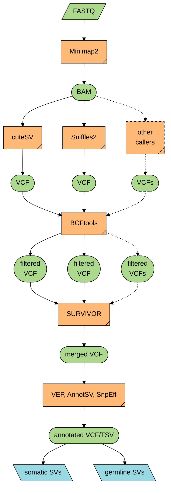

<!-- markdownlint-configure-file {"no-inline-html": {"allowed_elements": ["code", "details", "h2", "summary"]}} -->

# A snakemake pipeline to call structural variants from tumor-only ONT data


> :warning: This pipeline is in its early stages. Please use with caution.

## Author

Minghao Jiang, <jiang01@icloud.com>

## Tools Used

See the [simple caller guide](docs/callers-guide.md) for what each caller does,
which callers are enabled, and the original project URLs.

- SV callers

   [cuteSV](https://github.com/tjiangHIT/cuteSV), [Sniffles](https://github.com/fritzsedlazeck/Sniffles), [SVIM](https://github.com/eldariont/svim), [SVision](https://github.com/xjtu-omics/SVision), [Severus](https://github.com/KolmogorovLab/Severus), [NanoSV](https://github.com/mroosmalen/nanosv), [NanoVar](https://github.com/cytham/nanovar), [Delly](https://github.com/dellytools/delly), [Debreak](https://github.com/Maggi-Chen/DeBreak)

- Annotation tools

   [AnnotSV](https://github.com/lgmgeo/AnnotSV), [VEP](https://www.ensembl.org/info/docs/tools/vep/index.html), [SnpEff](http://pcingola.github.io/SnpEff/snpeff/introduction/)

   Known issue: [AnnotSV/cuteSV INS `SV_length` mismatch](docs/annotsv-cutesv-ins-svlen.md).

- R packages

   [vroom](https://www.tidyverse.org/tags/vroom/), [tibble](https://tibble.tidyverse.org/reference/tibble-package.html), [glue](https://glue.tidyverse.org), [dplyr](https://dplyr.tidyverse.org), [tidyr](https://tidyr.tidyverse.org), [purrr](https://purrr.tidyverse.org), [GenomicRanges](https://github.com/Bioconductor/GenomicRanges), [stringr](https://stringr.tidyverse.org), [BiocParallel](https://github.com/Bioconductor/BiocParallel), parallel

- Other tools

   [Minimap2](https://github.com/lh3/minimap2), [SAMtools](https://github.com/samtools/samtools), [BCFtools](http://samtools.github.io/bcftools/bcftools.html), [SURVIVOR](https://github.com/fritzsedlazeck/SURVIVOR), [vcf2maf](https://github.com/mskcc/vcf2maf), [SnpSift](http://pcingola.github.io/SnpEff/snpsift/introduction/), [duphold](https://github.com/brentp/duphold)

## Pipeline Structure

For a detailed, rule-level DAG of the configured workflow, including resource
preparation and both consensus stages, see [Detailed Snakemake DAG](docs/workflow-dag.md)
and its [Graphviz source](docs/workflow-dag.dot).



<details>

<summary><h2>Recommended Project Structure</h2></summary>

```text
project/
├── data/
│   └── wgs/
│       └── sample_xx.fq.gz
├── code/
│   └── wgs/
│       └── smk_sv/
└── analysis/
    └── wgs/
        ├── cutesv/
        |   └── sample_xx/
        |       └── merged/
        |           └── filtered/
        ├── sniffles/
        |   └── sample_xx/
        |       └── merged/
        |           └── filtered/
        └── survivor/
            └── sample_xx/
                └── final/
```

</details>

## Prerequisites

- [**Python**](https://www.python.org)
- [**Snakemake**](https://snakemake.github.io)
- [**eido**](https://pep.databio.org/eido/)
- [**SAMtools**](https://www.htslib.org)
- [**Mamba**](https://mamba.readthedocs.io/en/latest/) (recommended) or [**conda**](https://docs.conda.io/projects/conda/en/stable/)

Additional dependencies are automatically installed by **Mamba** or **conda**. Environments are defined in yaml files under `workflow/envs/`.

```shell
# ---------------------------------------------------------------------------- #
# Install Mamba and SAMtools manually. Since conda-packaged SAMtools           #
# occasionally encounters issues, this workflow presumes that samtools is      #
# executable within your system's PATH.                                        #
# ---------------------------------------------------------------------------- #
if ! command -v mamba &> /dev/null; then
    "${SHELL}" <(curl -L micro.mamba.pm/install.sh)
    source ~/.bashrc
fi

if ! command -v samtools &> /dev/null; then
    [ -d ${HOME}/.local/opt ] || mkdir -p ${HOME}/.local/opt
    wget 'https://github.com/samtools/samtools/releases/download/1.25/samtools-1.25.tar.bz2'
    tar -xvf samtools-1.25.tar.bz2
    cd samtools-1.25
    ./configure --prefix=${HOME}/.local/opt/samtools
    make
    make install
    echo "export PATH=\${HOME}/.local/opt/samtools/bin:\${PATH}" >> ~/.bashrc
    source ~/.bashrc
    rm -rf samtools-1.25 samtools-1.25.tar.bz2
fi

# Install Snakemake and eido using pipx (https://pipx.pypa.io/stable/)
pipx install snakemake
pipx inject snakemake eido

# Clone the repository
git clone https://github.com/jasonwong-lab/smk_sv.git
cd smk_sv/

# Initialize configuration
cp config/.config.yaml config/config.yaml
cp config/pep/.config.yaml config/pep/config.yaml
cp workflow/profiles/default/.config.yaml workflow/profiles/default/config.yaml
```

## Configuration

### Main Configuration

<details>

<summary>Edit <code>config/config.yaml</code></summary>

```yaml
run:
  dir: /projects/SV/analysis/wgs_t2t
workflow:
  mapper: minimap2
  callers:
  - cutesv
  - severus
  - sniffles
  - svim
  - svision
  annotators:
  - vep
  - snpeff
  - annotsv
inputs:
  fasta: /doc/reference/T2T-CHM13v2.0/chm13v2.0.fa
  index_minimap2: /doc/reference/minimap2/T2T-CHM13v2.0/chm13v2.0.mmi
  dir_data: /projects/SV/data/wgs
  suffix_fastq: .fq.gz
filtering:
  missing_population_af: keep  # keep, exclude, or error; unknown is not AF=0
  min_reads: 3
  min_length_reads: 1000
  min_quality_mapping: 20
  min_coverage: 6
  min_size: 100
  max_size: 10000000
  min_dhffc: 0.7
  max_dhbfc: 1.3
  distance_sv:
    BND: 10
    DEL: 10
    INS: 10
    INV: 10
    DUP: 10
  n_callers:
    BND: 3
    DEL: 3
    INS: 3
    INV: 3
    DUP: 3
  consider_type:
    BND: false
    DEL: false
    INS: false
    INV: false
    DUP: false
  consider_strand:
    BND: false
    DEL: false
    INS: false
    INV: false
    DUP: false
  estimate_distance:
    BND: true
    DEL: true
    INS: true
    INV: true
    DUP: true
annotation:
  terms_relative: leuka?emia|blood|lymph|myelo|ha?ema|marrow|platel|thrombo|anemia|neutro
  species: homo_sapiens
  genome: CHM13
  snpeff:
    version: 'v2.0'
    cache: /doc/snpeff
    build:
      genes: /doc/reference/T2T-CHM13v2.0/chm13v2.0_RefSeq_Liftoff_v5.3.gff
      format: gff3
      cds: null      # Optional matching CDS FASTA for build verification
      protein: null  # Optional matching protein FASTA for build verification
  vep:
    version: 116
    mode: gff
    annotation: /doc/reference/T2T-CHM13v2.0/chm13v2.0_GENCODEv35_CAT_Liftoff.vep.gff3
    max_size: 10000000
  annotsv:
    version: v3.5
    cache: /doc/tool/annotator/annotsv
caller_settings:
  tandem_repeats: /doc/reference/T2T-CHM13v2.0/chm13.bed
  nvtr: /doc/reference/T2T-CHM13v2.0/chm13.bed
  nanosv:
    config: /doc/nanosv/config.ini
    bed: null  # Supply a CHM13 sampling BED if enabling NanoSV
  clair3:
    model: /doc/clair3/models/pytorch/r941_prom_sup_g5014
  svision:
    model: /doc/svision/svision-cnn-model.ckpt
```

</details>

### Execution Profile

<details>

<summary>Edit <code>workflow/profiles/default/config.yaml</code></summary>

```yaml
software-deployment-method:
  - apptainer
  - conda
apptainer-args: "--bind /"
conda-prefix: /.snakemake/envs/smk_sv
scheduler: greedy
rerun-trigger: mtime
printshellcmds: True
keep-incomplete: True
cores: all
resources:
  mem_mb: 500000  # 500GB
default-resources:
  mem_mb: 10000  # 10GB
set-threads:
  annotate_sv_snpeffnvep: 10
  annotsv: 10
  filter_sv_annotation: 10
  filter_sv: 10
  clair3: 10
  cutesv: 10
  debreak: 10
  nanosv: 10
  nanovar: 10
  severus: 10
  snpeff: 10
  sniffles: 10
  svision: 10
  minimap2: 10
  minimap2_index: 10
  vep: 10
set-resources:
  snpeff:
    mem_mb: 50000
  svision:
    runtime: 72h
```

</details>

### Sample Metadata

This workflow uses [**Portable Encapsulated Projects (PEP)**](https://pep.databio.org/) for sample management.

<details>

<summary>Edit <code>config/pep/config.yaml</code></summary>

```yaml
pep_version: 2.1.0
sample_table: samples.csv    # Path to the sample table (Required)
```

</details>

The sample table must include one mandatory column:

| **sample_name**                   |
| --------------------------------- |
| Unique identifier for each sample |

## Reference resources

The workflow can download the reference data required by the selected callers and
annotators. URLs and checksums are defined under `resources.downloads` in
`config/config.yaml`. The bundled sources target **T2T-CHM13v2.0** (`CHM13`),
using the `chr*` analysis set including HG002-derived chrY and matching Severus
CHM13 repeat intervals. The tracked template is `config/.config.yaml`; local
`config/config.yaml` is ignored by Git. Rebuild the minimap2 index and realign
reads into a **new run directory** when migrating from GRCh38; do not reuse
GRCh38 BAMs, VCFs, repeat tracks, or annotation caches.

Review the configured output paths and available disk space (the two AnnotSV
archives alone are about 11.5 GB before extraction), then prepare all required
resources with:

```shell
snakemake resources --cores 4
```

This target prepares the reference FASTA and its indexes, tandem-repeat tracks,
selected caller models, AnnotSV data, and a **locally built CHM13 SnpEff database**.
The SnpEff build runs automatically when its cache is missing; see below.

**VEP now uses local GFF/GTF transcript models and the matching FASTA, without
an Ensembl cache or database connection.** The resource target downloads,
validates, coordinate-sorts, bgzips and tabix-indexes its CHM13 gene annotations.
AnnotSV accepts `genomeBuild=CHM13`; its `v3.5` annotation-data release is independent
of the installed AnnotSV patch version.

Downloads are resumable and checksummed where available. Clair3 now uses PyTorch
models (`pileup.pt`, `full_alignment.pt`); the default retains R9.4.1/Guppy5
chemistry, **not** a switch to R10.4.1. Override `caller_settings.clair3.model` and
`resources.downloads.clair3_model` together if your sequencing chemistry differs.
A new `pytorch/` model path avoids reusing old TensorFlow checkpoints.
NanoSV also needs a CHM13-compatible `caller_settings.nanosv.bed` if enabled.

Individual resources can also be supplied manually at the paths in
`config/config.yaml`; existing files are not downloaded again. The normal analysis
DAG depends on the same resource outputs, so a missing resource is prepared
automatically.

### Build the custom SnpEff database

The workflow follows the official [SnpEff database-building guide](https://pcingola.github.io/SnpEff/snpeff/build_db/):
register the genome, stage the reference and gene annotations, run `snpEff build`,
and perform CDS/protein verification when matching sequence files are supplied.

```shell
# Build SnpEff only (does not require a VEP cache):
snakemake build_snpeff_cache --cores 4

# Override the default 32 GB memory request if needed:
snakemake build_snpeff_cache --cores 4 --set-resources build_snpeff_cache:mem_mb=48000
```

The default downloads checksummed **CHM13 RefSeq/Liftoff v5.3 GFF3** (including
curated Y annotations) from the official T2T analysis set and validates every
feature's contig and coordinates against the configured FASTA index. This gene
annotation covers chr1–chr22, chrX, and chrY; it does not provide chrM gene models.
It installs
`CHM13.v2.0/snpEffectPredictor.bin`, a private `snpEff.config`, and
`build_manifest.json` under `annotation.snpeff.cache`. Annotation jobs automatically
use that config; no installed SnpEff files are edited. Logs are written to
`logs/resources/snpeff_build.log` under the run directory.

**Verification caveat:** default `cds: null` and `protein: null` explicitly pass
`-noCheckCds -noCheckProtein`, as described in the official guide. This produces
a usable database but does **not** independently validate its predicted coding
sequences. Supply matching CDS and/or protein FASTAs from the **same annotation
release**, with transcript IDs as FASTA identifiers, to enable those checks.
Do not substitute GRCh38 sequences or unrelated CAT/Liftoff proteins. Review the
build log for warnings before interpreting results.

For local annotations, set `annotation.snpeff.build.genes` to an existing file;
otherwise `resources.downloads.snpeff_genes` supplies it. GTF is supported with
`format: gtf22` (the guide recommends GTF when a suitable one is available); the
default uses its documented GFF3 build option. Compressed `.gz` inputs are also
supported. Existing cache directories are reused; to rebuild an older manually
prepared cache, back it up first, then use `--forcerun build_snpeff_cache`.
Omit the `annotation.snpeff.build` block to retain prebuilt-database download mode
for assemblies such as GRCh38.

Allow space for the reference, the expanded annotation (about 1.3 GB), and the
resulting SnpEff database. Inputs are linked into the build, not copied. The JVM
heap uses 90% of the requested memory to leave room for native JVM overhead.

### Offline VEP and robust annotation filtering

```shell
# Download and prepare just the local VEP transcript annotation:
snakemake prepare_vep_annotation --cores 4
```

The default is the official T2T **GENCODEv35 CAT/Liftoff VEP-formatted GFF3**;
`resources.downloads.vep_genes` pins its URL and SHA-256 checksum. Existing local
GFF/GTF files can be supplied through `annotation.vep.annotation`, with
`mode: gff` or `mode: gtf`. Supply complete gene/transcript/exon models and valid
parent IDs; exon-only GTFs can otherwise produce intergenic-only results in VEP.
Preparation checks contigs and coordinates against
the FASTA index, then creates `<annotation>.sorted.gz` and its `.tbi` index.
Allow disk space for several expanded copies during sorting.

VEP uses `--gff`/`--gtf` and `--fasta`, without `--database` or cache options.
**Do not add VEP's literal `--offline` flag in this mode:** in VEP 116 it implies
cache loading. Local transcript mode has been tested in a network-disabled Linux
container. Legacy Ensembl-cache use remains available with `mode: cache`,
`cache: <directory>`, and a matching assembly/cache release.

SnpEff uses RefSeq/Liftoff v5.3, whereas the VEP-formatted source uses GENCODEv35
CAT/Liftoff. Both match CHM13 coordinates but have different gene/transcript
models; do not expect identical transcript IDs or consequences.

**Population frequencies, known-variant IDs and cache-only predictions are not
provided by transcript-only annotation.** Do not interpret missing AF as zero or
as evidence that a variant is rare. Configure `filtering.missing_population_af`:

- `keep` (default): retain unknown-frequency evidence and issue a warning.
- `exclude`: remove variants with no measured population AF from the final
  selection, even if another annotation branch would retain them.
- `error`: stop when population AF is unknown, including selected IDs missing
  from the VEP MAF entirely.

The annotation table records `VEP.population_AF_status` (`observed` or `unknown`)
and `VEP.population_AF_max`. Measured AF=0 is distinct from unknown. Available
frequency values still feed the existing VEP frequency filter; the existing
non-stringent evidence-merging/rescue behavior is otherwise preserved. Add
appropriate **CHM13-coordinate** population data separately if frequency-based
selection is required; these data are not supplied automatically here.

AnnotSV TSVs are read by header, not a fixed column count. Missing optional
annotations become NA with warnings; missing required IDs/coordinates or malformed
tables stop the run. The R environment includes BCFtools. Filtering commands are
checked, outputs are installed only after success, and empty selections yield
valid header-only VCFs rather than silently retaining every record.

## Execution

### Local Execution

```shell
# Create environments
snakemake --conda-create-envs-only

# Run the workflow
snakemake
```

### Cluster Execution

If you want to run this pipeline on a cluster (*e.g.*, SLURM, or PBS), you should customise your own profile and place it into `~/.config/snakemake/`, and then run the pipeline with the profile:

```shell
snakemake --profile <your_profile_name>
```

Or run the pipeline with the profile you have set as an environment variable:

```shell
export SNAKEMAKE_PROFILE=<your_profile_name>
snakemake
```

You can refer to the profile I have been using (`workflow/profiles/mycluster`):

```shell
[ -d ~/.config/snakemake ] || mkdir -p ~/.config/snakemake
ln -s `pwd`/workflow/profiles/mycluster ~/.config/snakemake/
```

## License

Codes here are licensed under the [GNU General Public License v3](http://www.gnu.org/licenses/gpl-3.0.html).
