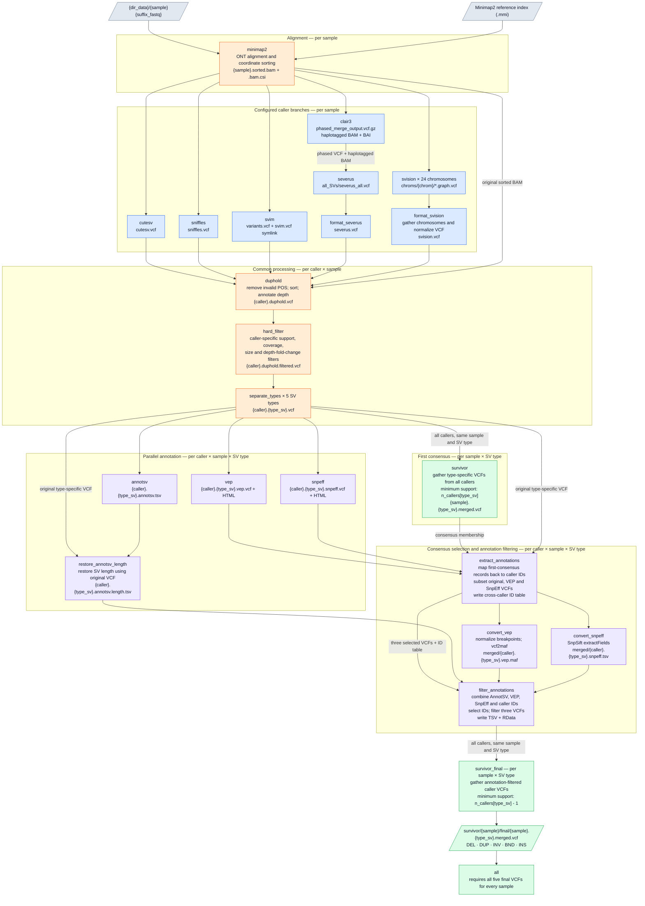
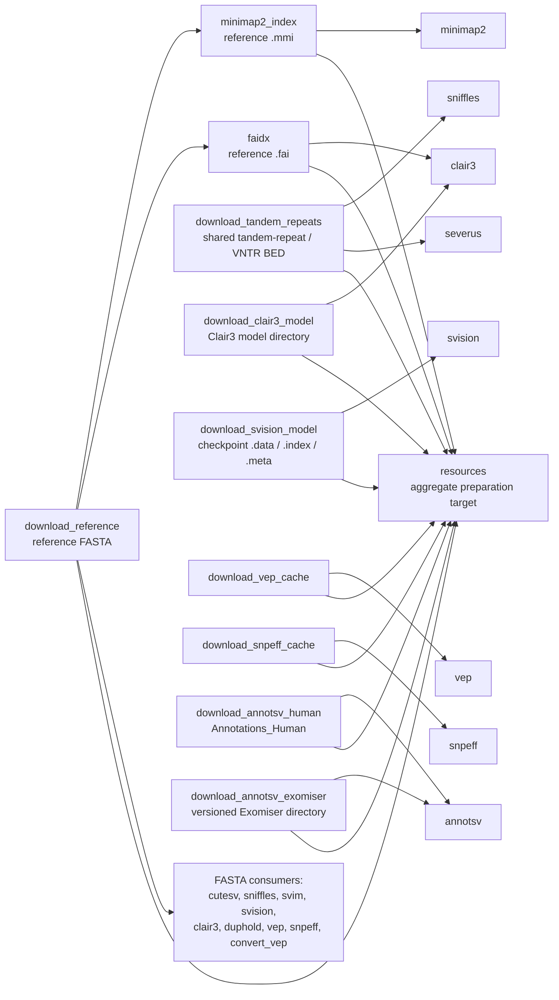

# Detailed Snakemake DAG

This is a **source-derived draft**, not a successfully executed `snakemake --dag`
export. It follows `workflow/Snakefile`, the included rule files, and the five
callers and three annotators selected in `config/config.yaml`.

The editable Graphviz equivalent is [workflow-dag.dot](workflow-dag.dot).

## Scope and notation

- Arrows point from prerequisites to consumers. Boxes name actual Snakemake rules;
  labels identify their principal products. Input/output nodes are artifacts, not
  additional jobs.
- `{sample}` expands over PEP `sample_name` values.
- `{caller}` expands over `cutesv`, `severus`, `sniffles`, `svim`, and `svision`.
- `{type_sv}` expands over `DEL`, `DUP`, `INV`, `BND`, and `INS`.
- SVision additionally expands over `chr1`–`chr22`, `chrX`, and `chrY`.
- The common caller-processing block represents **five parallel copies per
  sample**; its type-specific stages represent **25 copies per sample**. Each
  SURVIVOR rule represents five jobs per sample, gathering all five callers for
  one SV type. Shared reference/model/cache preparation is not repeated per sample.
- The diagrams show declared file dependencies, not every file a tool may open
  internally. Temporary files, logs, and most reports are omitted for readability.

## 1. Main analysis DAG

Reference, model, and annotation-cache inputs are separated into the resource
view below to keep the main graph readable.



### Important dependency details

1. **Annotation is caller-specific, not annotation of the merged VCF.** `vep`,
   `snpeff`, and `annotsv` all consume `{caller}/{sample}/{caller}.{type_sv}.vcf`.
   They can run concurrently with the first `survivor` job. `extract_annotations`
   waits for that consensus and the VEP/SnpEff outputs, then subsets caller VCFs
   by their consensus-associated IDs.
2. **Clair3 is a prerequisite of Severus, not an SV consensus contributor.** It
   supplies phasing and haplotagging. It is included in the Snakefile but is not
   listed in the configured `CALLERS` collection.
3. **duphold always uses the original mapper BAM**, including for Severus-derived
   VCFs; only Severus itself uses the Clair3 haplotagged BAM.
4. **AnnotSV length restoration uses the original type-specific VCF**, not a
   consensus-subset VCF. `filter_annotations` subsequently restricts AnnotSV rows
   using the consensus ID table.
5. **Two consensus thresholds are used.** In the current configuration the first
   merge requires three callers and the final merge requires two, independently
   for each SV type. Both use `distance_sv[type_sv] = 10`, ignore type and strand
   in SURVIVOR's matching flags, and enable size-based distance estimation via
   `estimate_distance`. The distance setting should therefore not be described
   simply as a fixed 10-bp window.
6. **There is no separate somatic/germline classification output in this DAG.**
   The final targets are annotation-filtered consensus SV VCFs. Tumor-only input
   and annotation filtering do not establish somatic status on their own.

## 2. Shared resource DAG

These rules provide resources for the main graph. Existing resources can be
reused; missing ones are prepared through the corresponding producer rules.
`resources` is an alternative aggregate target, **not** a prerequisite of `all`.
The normal analysis depends directly on the resource files it needs.



`caller_settings.nvtr` and `caller_settings.tandem_repeats` currently point to the
same BED, so `download_tandem_repeats` serves both Severus and Sniffles. If those
paths differ, a separate `download_nvtr` rule supplies Severus and the `resources`
target. NanoSV-only resources are outside the configured analysis.

## 3. Key artifacts

Paths below are relative to `run.dir`, except configured input/cache paths.

| Stage | Rule | Principal output |
| --- | --- | --- |
| Alignment | `minimap2` | `minimap2/{sample}/{sample}.sorted.bam` and `.bam.csi` |
| Phasing | `clair3` | `clair3/{sample}/phased_merge_output.vcf.gz`, phased BAM/BAI, and `{sample}.sorted.haplotagged.bam`/BAI symlinks |
| Caller normalization | caller rule or formatter | `{caller}/{sample}/{caller}.vcf` |
| Depth annotation | `duphold` | `{caller}/{sample}/{caller}.duphold.vcf` |
| Hard filtering | `hard_filter` | `{caller}/{sample}/{caller}.duphold.filtered.vcf` |
| Type splitting | `separate_types` | `{caller}/{sample}/{caller}.{type_sv}.vcf` |
| First consensus | `survivor` | `survivor/{sample}/{sample}.{type_sv}.merged.vcf` |
| Annotation | `vep`, `snpeff`, `annotsv` | `{caller}/{sample}/{caller}.{type_sv}.{vep.vcf,snpeff.vcf,annotsv.tsv}` |
| Length correction | `restore_annotsv_length` | `{caller}/{sample}/{caller}.{type_sv}.annotsv.length.tsv` |
| Consensus-associated subsets | `extract_annotations` | `{caller}/{sample}/merged/{caller}.{type_sv}.{vcf,vep.vcf,snpeff.vcf}` and `survivor/{sample}/{sample}.{caller}.{type_sv}.tab` |
| Annotation conversion | `convert_vep`, `convert_snpeff` | `{caller}/{sample}/merged/{caller}.{type_sv}.{vep.maf,snpeff.tsv}` |
| Annotation filtering | `filter_annotations` | `{caller}/{sample}/merged/filtered/{caller}.{type_sv}.{vcf,vep.vcf,snpeff.vcf,tsv,RData}` |
| Final consensus | `survivor_final` | `survivor/{sample}/final/{sample}.{type_sv}.merged.vcf` |

Brace suffix lists in this table are shorthand, not literal filenames.

## 4. Other available caller branches

The following modules exist but are **not selected** in the current configuration.
They are deliberately excluded from the main DAG rather than presented as active
or validated branches.

| Caller | Source-declared chain before `duphold` | Caveat |
| --- | --- | --- |
| DeBreak | mapper BAM + FASTA → `debreak` → `format_debreak` → `debreak.vcf` | Formatter rename-table path overlaps other formatter outputs if enabled together. |
| Delly | mapper BAM + FASTA → `delly` → `format_delly` → `delly.vcf` | Formatter writes `debreak/{sample}/rename.tab`, also used by `format_severus`. |
| NanoSV | mapper BAM + NanoSV config → `nanosv` → **broken formatter dependency** | `nanosv` produces `tmp.vcf`, but `format_nanosv` declares its own final VCF as both input and output. Sampling BED is passed via `params`, not declared as an analysis input. |
| NanoVar | mapper BAM + FASTA → `nanovar` → formatter → `nanovar.vcf` | Its formatter is named `format_nanosv`, colliding with NanoSV's formatter if both modules are included. |

Although the schema permits reduced annotator lists, the downstream
`extract_annotations` and `filter_annotations` rules unconditionally require all
three annotation tools' products. This draft therefore assumes all three remain
enabled. Similarly, adding `clair3` to `workflow.callers` is not represented as a
valid SV branch: Clair3 is already included separately and does not produce the
`{caller}/{sample}/{caller}.vcf` expected by `duphold`.

## 5. Render or regenerate

### Render the source-derived draft

Open this Markdown file in a Mermaid-capable viewer, or use Graphviz for the
combined analysis/resource graph:

```bash
# From the repository root; requires Graphviz's `dot` executable.
dot -Tsvg docs/workflow-dag.dot -o docs/workflow-dag.svg
dot -Tpdf docs/workflow-dag.dot -o docs/workflow-dag.pdf
```

### Export Snakemake's actual instantiated DAG

After configuring the environment, real samples, and resources:

```bash
# Explicitly select `all`: resource rules are included before rule all.
snakemake --snakefile workflow/Snakefile all --dry-run

# One node per concrete job, expanded across samples/callers/types/chromosomes.
# Separate generation and rendering so a failed Snakemake command does not
# silently leave an empty PDF through a shell pipeline.
snakemake --snakefile workflow/Snakefile all --dag > dag.dot &&
    dot -Tpdf dag.dot -o dag.pdf

# Compact rule-level view.
snakemake --snakefile workflow/Snakefile all --rulegraph > rulegraph.dot &&
    dot -Tsvg rulegraph.dot -o rulegraph.svg

# Resource-preparation graph only.
snakemake --snakefile workflow/Snakefile resources --dag > resources.dot &&
    dot -Tsvg resources.dot -o resources.svg
```

`--rulegraph` collapses wildcard instances; use `--dag` when the actual job fan-out
is important. Depending on existing outputs, an instantiated DAG may differ from
the full source-derived view.

### Local export limitations observed while drafting

- The installed `snakemake` entry point fails during import with
  `ModuleNotFoundError: No module named 'tenacity'`.
- Graphviz's `dot` executable was not found on `PATH`.
- `config/pep/config.yaml` and its sample table are absent; only the PEP template
  `config/pep/.config.yaml` is present.
- `config/config.yaml` has `resources.downloads: {}`. The AnnotSV resource output
  helper requires `annotsv_exomiser.version` even when caches already exist;
  missing downloadable inputs also need appropriate URLs. The configuration
  template `config/.config.yaml` contains example resource definitions.
- The configured input and run paths refer to an external analysis environment.

No pipeline rules, configuration, or existing `dag.pdf` were changed to produce
this documentation.
